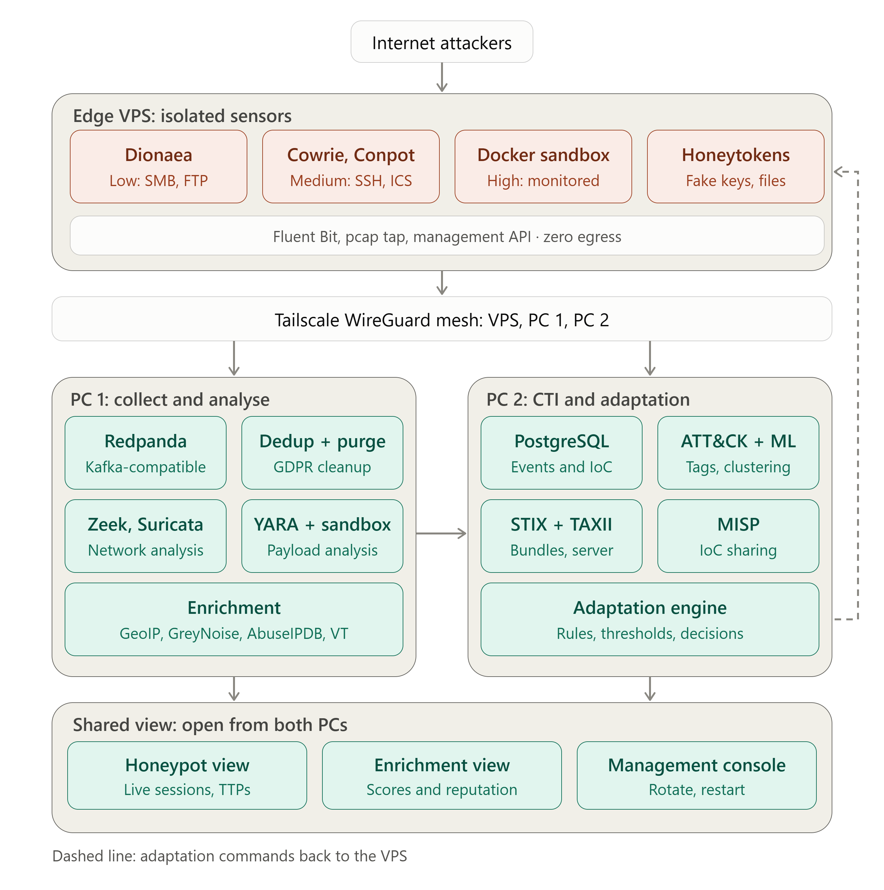

# HoneyDeception-CTI

Adaptive honeypot platform that turns attacker behaviour into Cyber Threat Intelligence (STIX/MISP) and uses it to reconfigure the honeypots automatically.

Honeypots capture attacks, a pipeline cleans and enriches them, an intelligence layer tags and shares them, and an adaptation engine sends new configurations back to the sensors.



## How it works

| Layer | Role | Runs on |
|---|---|---|
| **Sensors** | Cowrie, Dionaea, Conpot, honeytokens. Attract and record attacks | Isolated VM (Phase 0), Edge VPS (Phase 1) |
| **PC 1: collect and analyse** | Redpanda, dedup + purge, Zeek/Suricata, YARA + sandbox, enrichment | Machine 1 (16 GB) |
| **PC 2: CTI and adaptation** | PostgreSQL, ATT&CK + ML, STIX/TAXII, MISP, adaptation engine | Machine 2 (16 GB) |

All machines are connected through a **Tailscale (WireGuard) mesh**. Full details, workflow and RAM budget: [`docs/ARCHITECTURE.md`](docs/ARCHITECTURE.md) (PDF version: [`docs/HoneyDeception_CTI_Architecture.pdf`](docs/HoneyDeception_CTI_Architecture.pdf)).

## Team

| Person | Owns | Folder |
|---|---|---|
| Youssef | PC 2: CTI and adaptation | `pc2/` |
| Marouane | PC 1: collect and analyse | `pc1/` |
| Both | Sensors, shared dashboards | `sensors/`, `shared/` |

## Repository layout

```
honeydeception-cti/
|-- docs/            Architecture, diagrams, step-by-step guides
|   |-- steps/       One guide per build step
|-- sensors/         Honeypot configs (Cowrie, Dionaea, Conpot, Fluent Bit)
|-- pc1/             Pipeline: Redpanda, dedup, Zeek/Suricata, YARA, enrichment
|-- pc2/             CTI: PostgreSQL, ATT&CK/ML, STIX/TAXII, MISP, adaptation
|-- shared/          Dashboards and management console
|-- .env.example     Template for local secrets (copy to .env)
```

## Roadmap

We start with a **local lab** (no VPS), then move the sensors to a VPS for real traffic.

- [ ] **Step 1:** Foundation: GitHub, Tailscale, Docker on both PCs ([guide](docs/steps/01-foundation.md))
- [ ] **Step 2:** Isolated sensor VM (Cowrie + Fluent Bit)
- [ ] **Step 3:** Redpanda on PC 1, events flowing
- [ ] **Step 4:** Dedup/purge + PostgreSQL schema
- [ ] **Step 5:** Enrichment (GeoIP, then AbuseIPDB and GreyNoise)
- [ ] **Step 6:** Dionaea + YARA, then Zeek and Suricata
- [ ] **Step 7:** ATT&CK tagging (rule-based first)
- [ ] **Step 8:** STIX export, TAXII and MISP
- [ ] **Step 9:** Shared dashboards
- [ ] **Step 10:** Adaptation engine
- [ ] **Step 11:** Move sensors to a VPS (Phase 1)

## Working together

- `main` is always working. Do not push to it directly.
- Create a branch per task: `pc2/postgres-schema`, `pc1/redpanda-setup`, `docs/step-02`.
- Open a Pull Request, let the other person review, then merge.
- Commit small and often, with clear messages (`pc2: add events table`).
- **Never commit** secrets (`.env`), API keys, pcaps, logs, or malware samples. `.gitignore` covers the common cases, but double-check before you push.

## Security notes

- Honeypots run isolated with **no outbound internet access**.
- The management API is reachable only through Tailscale.
- IP addresses and session data are personal data (GDPR): keep retention short and purge raw data.
- Malware samples stay inside the sandbox storage, never on a daily-use machine.

## Status

Phase 0 (local lab). Work in progress.
