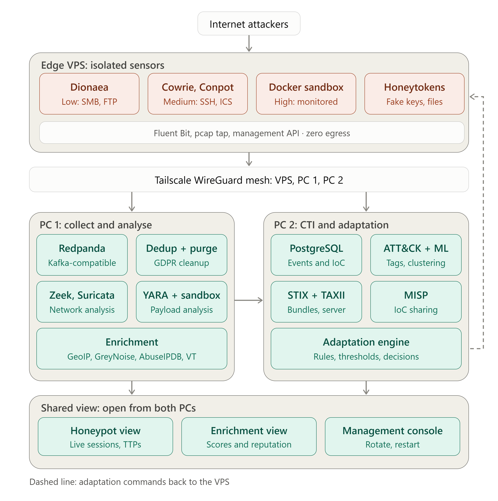
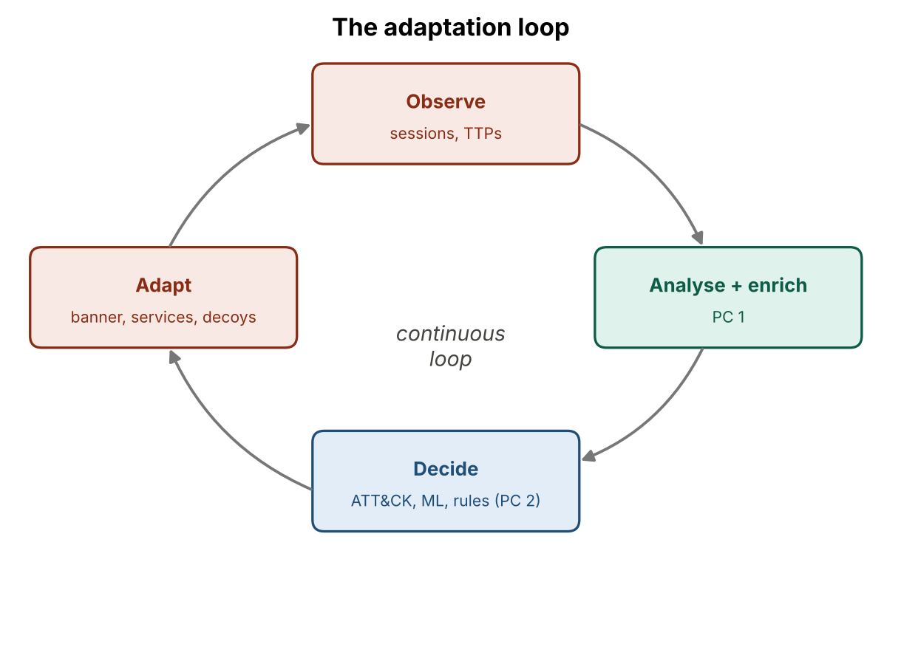
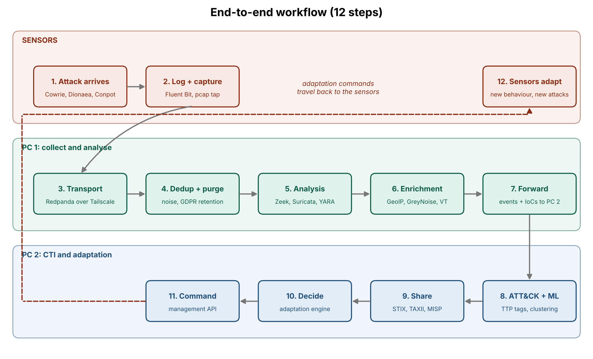
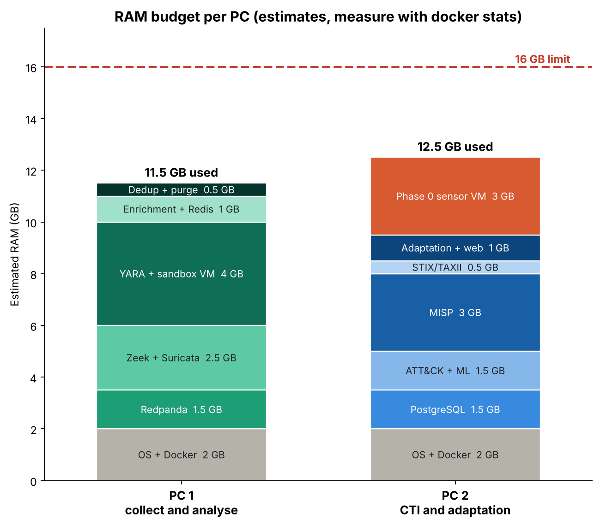
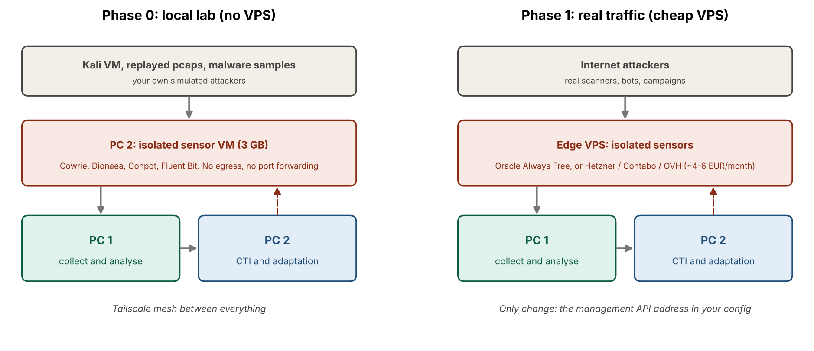

# HoneyDeception-CTI: Architecture and Workflow

Two-PC setup (16 GB RAM each), starting without a VPS.

---

## 1. Goal

Capture real attacker behaviour with honeypots, analyse and enrich it, turn it into structured Cyber Threat Intelligence (STIX/MISP), and use that intelligence to **adapt the honeypots automatically** (change services, banners, fake data, interaction level).

The project has three layers:

| Layer | Role | Where it runs |
|---|---|---|
| **Sensors** | Attract and record attacks | Edge VPS (later) / local isolated VM (Phase 0) |
| **Collect and analyse** | Transport, deduplicate, analyse, enrich | PC 1 |
| **CTI and adaptation** | Store, tag, cluster, share, decide | PC 2 |

All machines talk over a **Tailscale (WireGuard) mesh**. Nothing is exposed except the sensors.

---

## 2. Architecture overview



*Text version of the same diagram:*

```
 Internet attackers (Phase 1)  /  your own Kali + replayed pcaps (Phase 0)
              |
              v
 +--------------------------------------------------------+
 |  SENSORS (isolated, zero egress)                       |
 |  Dionaea | Cowrie + Conpot | Docker sandbox | Honeytokens |
 |  Fluent Bit + pcap tap + management API                |
 +--------------------------------------------------------+
              |  Tailscale WireGuard mesh
      +-------+--------------------+
      v                            v
 +-----------------------+    +-------------------------+
 | PC 1: collect/analyse | -> | PC 2: CTI + adaptation  |
 | Redpanda              |    | PostgreSQL              |
 | Dedup + purge         |    | ATT&CK tagging + ML     |
 | Zeek, Suricata        |    | STIX + TAXII, MISP      |
 | YARA + sandbox        |    | Adaptation engine       |
 | Enrichment            |    +------------+------------+
 +-----------------------+                 |
                                           | adaptation commands
                                           v
                                  back to the sensors
                                  (management API)

 Shared view (open from both PCs): Honeypot view, Enrichment view,
 Management console
```

---

## 3. The sensors

Deployed in three interaction levels plus decoys:

| Component | Level | What it captures |
|---|---|---|
| **Dionaea** | Low | SMB, FTP, malware samples dropped by exploits |
| **Cowrie** | Medium | SSH/Telnet sessions, commands typed, files downloaded |
| **Conpot** | Medium | ICS/SCADA protocols (Modbus, S7) |
| **Docker sandbox** | High | Monitored real-ish environment (later phase) |
| **Honeytokens** | Decoy | Fake API keys, credentials, files that alert when used |
| **Fluent Bit** | Shipper | Sends logs to Redpanda on PC 1 |
| **pcap tap** | Capture | Raw traffic for Zeek/Suricata |
| **Management API** | Control | Receives adaptation commands (rotate, restart, reconfigure) |

**Zero egress:** the sensors must not be able to initiate outbound connections to the internet, so a compromised honeypot cannot be used to attack others. They only talk to PC 1/PC 2 over Tailscale.

---

## 4. PC 1: Collect and analyse

PC 1 is the **data pipeline**. It receives everything from the sensors and produces clean, enriched events.

| Component | Role |
|---|---|
| **Redpanda** | Kafka-compatible message broker. Buffers events so nothing is lost if a downstream service is slow. |
| **Dedup + purge** | Removes duplicates and scanner noise. Handles **GDPR cleanup** (IP addresses are personal data, so retention limits and purge jobs apply). |
| **Zeek, Suricata** | Network analysis of the pcaps: protocols, flows, signature alerts. |
| **YARA + sandbox** | Scans captured payloads and detonates samples to extract behaviour and IoCs. |
| **Enrichment** | Adds context to each IP, hash or domain: GeoIP, GreyNoise, AbuseIPDB, VirusTotal. Uses a cache to stay within free API quotas. |

**Output of PC 1:** enriched events and IoCs, sent to PC 2.

---

## 5. PC 2: CTI and adaptation

PC 2 turns events into **intelligence** and **decisions**.

| Component | Role |
|---|---|
| **PostgreSQL** | Central store for events and IoCs. |
| **ATT&CK + ML** | Maps behaviour to MITRE ATT&CK techniques (TTPs) and clusters similar attackers/campaigns. |
| **STIX + TAXII** | Packages intelligence as STIX bundles and serves them through a TAXII server. |
| **MISP** | IoC sharing platform for collaboration and export. |
| **Adaptation engine** | Rules, thresholds and decisions. Example: "many SSH brute-forcers with a given tool: switch Cowrie banner and add a fake credentials file". Sends commands to the sensor management API. |

### The adaptation loop



---

## 6. Shared view

Three web interfaces reachable from **both PCs** over Tailscale:

- **Honeypot view:** live sessions and TTPs.
- **Enrichment view:** scores and reputation.
- **Management console:** rotate, restart, change configurations.

Host them on PC 2 (small web app or Grafana), and open them from either PC.

---

## 7. End-to-end workflow



1. **Attack arrives** at a sensor (Dionaea, Cowrie, Conpot or a honeytoken is triggered).
2. **Logging and capture:** Fluent Bit ships logs, the pcap tap records traffic, and dropped files are saved.
3. **Transport:** events travel over Tailscale into **Redpanda** on PC 1.
4. **Cleaning:** dedup removes duplicates and noise; retention rules are applied.
5. **Analysis:** Zeek/Suricata analyse traffic; YARA and the sandbox analyse payloads.
6. **Enrichment:** GeoIP, GreyNoise, AbuseIPDB and VirusTotal add context and a reputation score.
7. **Forward to PC 2:** enriched events and IoCs are written to **PostgreSQL**.
8. **Intelligence:** events are tagged with ATT&CK techniques and clustered by the ML component.
9. **Sharing:** STIX bundles are generated and published through TAXII and MISP.
10. **Adaptation:** the engine evaluates rules and thresholds and decides on a change.
11. **Command back:** the decision goes through the management API to the sensors (dashed line in the diagram), which changes behaviour.
12. **Loop:** the new behaviour attracts different attacker actions, and the cycle repeats.

---

## 8. RAM budget (2 x 16 GB)



These are **estimates**; measure with `docker stats` and adjust. Cap every service with memory limits.

### PC 1 (collect and analyse)

| Service | Approx. RAM |
|---|---|
| OS + Docker overhead | 2.0 GB |
| Redpanda (limit with `--memory 1G --smp 1`, dev mode) | 1.5 GB |
| Zeek + Suricata | 2.5 GB |
| YARA + sandbox VM | 4.0 GB |
| Enrichment worker + Redis cache | 1.0 GB |
| Dedup + purge worker | 0.5 GB |
| **Total** | **~11.5 GB** |
| Headroom | ~4.5 GB |

### PC 2 (CTI and adaptation, plus Phase 0 sensors)

| Service | Approx. RAM |
|---|---|
| OS + Docker overhead | 2.0 GB |
| PostgreSQL | 1.5 GB |
| ATT&CK tagging + ML (Python, scikit-learn) | 1.5 GB |
| MISP (MySQL, Redis, PHP) | 3.0 GB |
| STIX/TAXII server | 0.5 GB |
| Adaptation engine + web views | 1.0 GB |
| **Subtotal** | **~9.5 GB** |
| Phase 0 sensor VM (Cowrie, Dionaea, Conpot, Fluent Bit) | 3.0 GB |
| **Total** | **~12.5 GB** |
| Headroom | ~3.5 GB |

### Tips to stay within 16 GB

- Skip the **high-interaction Docker sandbox** in Phase 0.
- Start MISP only when you reach the sharing step; it is the heaviest component on PC 2.
- Run Suricata with a small ruleset first (Emerging Threats Open, limited categories).
- Use a swap file (4 to 8 GB) as a safety net, not as a working resource.
- Do not run the ML clustering and the sandbox detonation at the same time.

---

## 9. Phase plan



### Phase 0: local lab (no VPS)

- Sensor VM on PC 2 (isolated network, no internet egress, no inbound port forwarding).
- Traffic comes from **your own attacks** (Kali: nmap, hydra, Metasploit), **replayed pcaps**, and **malware samples** from MalwareBazaar, all inside the lab.
- Goal: prove the full pipeline and the adaptation loop work end to end.

### Phase 1: real traffic

- Move the sensors to an **Edge VPS** (Oracle Always Free, or a cheap Hetzner/Contabo/OVH VPS).
- Only the sensors go there. Everything else stays on PC 1 and PC 2.
- The only change is the management API address in your config, so keep it as a variable from day one.

---

## 10. Suggested build order

1. Tailscale on all machines, then the isolated sensor VM.
2. Cowrie + Fluent Bit, then **Redpanda**, so you see real events flowing.
3. Dedup/purge + **PostgreSQL** schema.
4. Enrichment (start with GeoIP, then AbuseIPDB/GreyNoise).
5. Dionaea + YARA, then Zeek/Suricata.
6. ATT&CK tagging (rule-based first).
7. STIX export, then TAXII and MISP.
8. Shared dashboards.
9. Adaptation engine (rules first, ML later when you have data).
10. Move sensors to a VPS (Phase 1).

---

## 11. Security and compliance notes

- **Isolation:** sensors on their own network segment, zero egress, no shared credentials with real systems.
- **Management API:** reachable only through Tailscale, with authentication and ACLs.
- **API keys** (VirusTotal, AbuseIPDB, GreyNoise): store in environment files or a secrets manager, never in the repo.
- **GDPR:** IPs and session data are personal data. Define retention periods, purge old raw data, and keep only what the CTI needs.
- **Malware handling:** samples live only in the sandbox storage, never on a machine you use daily.
- **Free API limits:** cache enrichment results aggressively (VirusTotal's free tier is very limited).
